
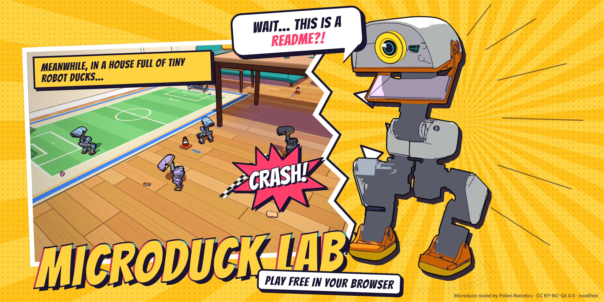

<h1 align="center">Microduck Lab VR</h1>

  Be the duck. A first-person VR version of <a href="https://github.com/R1chi33333/microduck-lab">Microduck Lab</a>:
  you are a 25 cm robot duck in a human-sized comic-book house, with a flock of other ducks who all have their own plans. 
  <b>Work in progress.</b>

---

## Status

All milestones of the port are in: the house, the flock, toys and the toy bag, roller skates, the laser,
football, the house race, emotes, swapping ducks, third person, the mirror, the garage and a first-run tutorial.
The browser version is [here](https://r1chi33333.github.io/microduck-lab-preview/); the plan is in
[docs/PORTING_PLAN.md](docs/PORTING_PLAN.md).

## Platform

- Unity 6000.6.7f1, Universal Render Pipeline, OpenXR
- Windows PC, Meta Quest Pro over Quest Link / Air Link
- Code conventions: [docs/CODE_STYLE.md](docs/CODE_STYLE.md)

## Playing

To install the game on another PC (no Unity needed), follow [docs/INSTALL.md](docs/INSTALL.md)
([中文](docs/INSTALL.zh-CN.md)).

1. Connect the Quest Pro with Quest Link and set Meta Horizon Link as the active OpenXR runtime.
2. Run `Builds/Windows/MicroduckLabVR.exe` (make it with **Microduck > Build Windows**), or open the project
   in Unity 6000.6.7f1 and press Play in `Assets/MicroduckVR/Scenes/House.unity`.

| Control | What it does |
|---|---|
| Left stick | Walk towards where you look (on skates: steer) |
| Right stick | Snap turn; in third person it aims your head (click: view behind you) |
| Right trigger | Open the beak; let go next to a toy to grab it, squeeze again to drop |
| A | Chirp |
| B | Roller skates on / off (left grip: drift, left trigger: boost) |
| X | Dance (at the mirror: bring out the board to make your duck) |
| Y | Toy bag: toys, bin, help, credits, football, race, swap duck, view, emotes |
| Right grip | Laser dot for the ducks to chase |
| Left stick click | First / third person |

On the desktop without a headset: WASD walk, Q/E turn, Space beak, C chirp, K skates, Tab bag, L laser, V view.

Two players on two PCs in the same house (local network, no accounts): **HOST** and **JOIN** in the toy bag,
see [docs/MULTIPLAYER.md](docs/MULTIPLAYER.md).

## How the ducks work

[中文说明](docs/DUCKS.zh-CN.md)

In the game the ducks use **no animation clips and no Animator**: every move is computed in code each frame from the robot's
15 joints (left and right `hip_yaw`, `hip_roll`, `hip_pitch`, `knee`, `ankle`, plus `neck_pitch`, `head_pitch`,
`head_yaw`, `head_roll` and `jaw`), the same way the browser version does it. Your duck and the AI ducks share the
same body code; only the thing that steers it differs (your controllers, or the AI brain).

### Every move

All recorded from the game's own duck code. The name under each one is its animation clip (`Duck_<name>.anim`) and
its Animator trigger.

<table>
<tr><td align="center">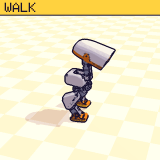 <code>Walk</code></td><td align="center">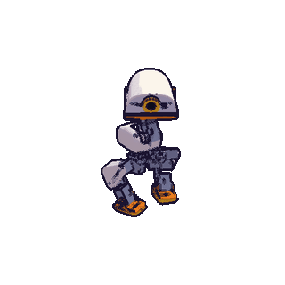 <code>Turn</code></td><td align="center">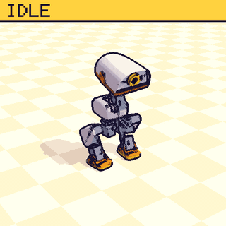 <code>Idle</code></td><td align="center">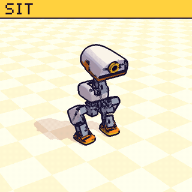 <code>Sit</code></td></tr>
<tr><td align="center">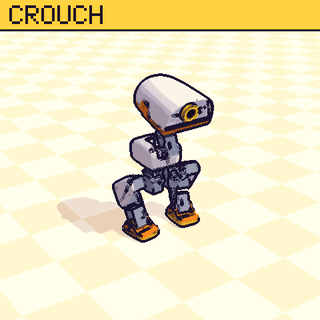 <code>Crouch</code></td><td align="center"> <code>Hop</code></td><td align="center">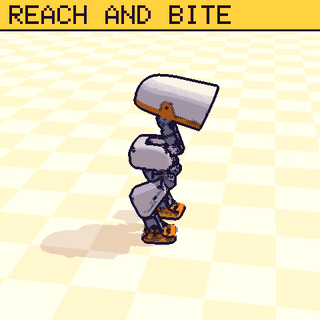 <code>Bite</code></td><td align="center"> <code>Nod</code></td></tr>
<tr><td align="center"> <code>Shake</code></td><td align="center">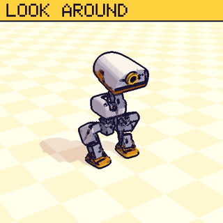 <code>Look</code></td><td align="center"> <code>Dance</code></td><td align="center">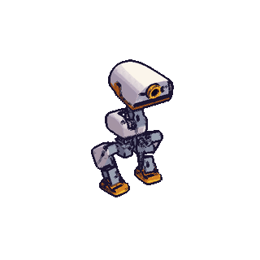 <code>Wiggle</code></td></tr>
<tr><td align="center">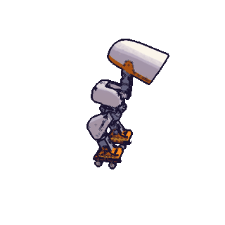 <code>Skate</code></td><td align="center">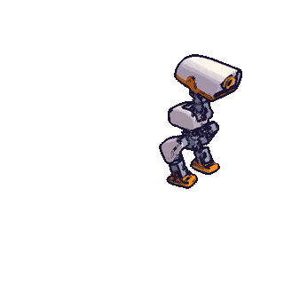 <code>FallGetUp</code></td></tr>
</table>

The same moves are also **Unity animation clips**, in `Assets/MicroduckVR/Prefabs/Ducks/Animations/` (and in the
`.unitypackage`):

- `Duck (animated).prefab`: the duck with an Animator, ready to drop into a scene. It idles; fire a trigger
  (`animator.SetTrigger("Dance")`) to play a move, and the one-off moves go back to idle by themselves.
- `Duck.controller` (one state and one trigger per move) and the 14 clips `Duck_*.anim` (30 fps; Idle, Walk and Turn
  loop). Walk and Skate are in place: move the duck yourself while they play. The skates are not part of the
  prefab, so `Skate` lifts the feet by the skates' height; add your own skates under the feet if you use it.

These are recordings: the game keeps moving its ducks in code. After changing a move in `DuckBody.cs`, record them
again with **Microduck > Assets > Bake Duck Moves** (the GIFs are made from the frames it writes to `Logs/motion/`).

### Where the code is

| File (under `Assets/MicroduckVR/`) | What it does |
|---|---|
| `Scripts/Flock/DuckBrain.cs` | **The AI ducks' brain.** Picks what each duck does, steers it round the house, plays the games, fetches toys. |
| `Scripts/Duck/DuckBody.cs` | **Every animation:** walking, turning, sitting, crouching, hopping, head look, beak reach and jaw, emotes, skating, falling and getting up. |
| `Scripts/Duck/DuckSetup.cs` | Builds a duck when the game starts from `Models/microduck_rig.glb` and `Models/DuckJointMap.asset` (joint axes, limits, standing pose) and applies its colours. |
| `Scripts/Flock/ThoughtBubbles.cs` | The comic speech bubbles over the AI ducks: one set of lines per behaviour. |
| `Scripts/Audio/DuckAudio.cs` | Each duck's own chirping voice and footsteps; reacts to the brain's events. |
| `Scripts/Flock/FlockSpawner.cs` | ADD DUCK / REMOVE DUCK in the toy bag (1 to 12 ducks). |
| `Editor/SceneBuilderHouse.cs` | The starting flock: 6 ducks, where they stand, their colours and random seeds (**Microduck > Build House**). |
| `Scripts/Net/NetFlock.cs` | Co-op: the host's brains decide, the joining PC's ducks copy them. |
| `Scripts/Player/PlayerDuck.cs` | Your duck (the same `DuckBody`, driven by your controllers). |
| `Scripts/Flock/WanderDuck.cs` | A very simple brain, used only by the `Duck (live)` prefab for other projects. |

### What the AI ducks do

When its timer runs out, a duck picks its next behaviour at random (`DuckBrain.Pick`):

| Behaviour | Chance | How long | What it looks like |
|---|---|---|---|
| `follow` | 30% | 8 to 16 s | Walks behind you in a loose V; with two players, ducks split between them. |
| `wander` | 24% | 7 to 13 s | Walks to a random spot nearby, sometimes emotes on arrival. |
| `toy` | 14% | up to 14 s | Finds a toy within 70 cm, walks up, bows, bites it, carries it for about 4.5 s, puts it down. |
| `roam` | 12% | up to 40 s | Walks to another room through the doorways. |
| `sit` | 10% | 3 to 6 s | Sits down for a rest. |
| `idle` | 10% | 1.5 to 3.5 s | Stands about; half the time plays an emote. |

These take over from that normal life while they last (`DuckBrain.Games`):

- **Race:** runs the course, each duck at a slightly different pace, dances at the finish.
- **Football:** the two ducks nearest the ball on each team chase it and kick it towards the other goal; the rest
  hold their positions.
  Everyone on the scoring team dances.
- **Laser dot:** ducks within 80 cm gather in a ring round the dot, then crouch and pounce on it.

All the time: ducks keep about 19 cm apart (from each other and from you), feel ahead for edges and furniture and
walk round them, get unstuck, step out of the way of a card or board you are reading, slide on tiles, slow down in
water and bounce on the bed. They tell the bubbles and the voice what happened: `got`, `drop`, `bed`, `water`, `tile`.

### What the body can do (animations in `DuckBody.cs`)

| Move | How it is driven |
|---|---|
| Walking and turning on the spot | Procedural gait: feet are planted and stepped with leg IK, pigeon-toed; the body sways, bobs and leans with speed |
| Sit, crouch | `SitTarget`, `CrouchTarget` (blended in and out) |
| Hop | `Hop` (height); used for the bed bounce and the laser pounce |
| Look at something | `LookAt.target` / `LookAt.weight`; the head also stays steady while walking and tilts when idle |
| Reach with the beak, open and close it | `ReachState` (neck and head bend until the beak meets the target), `JawTarget` |
| Happy wiggle | `HappyWiggle` |
| Emotes | `PlayEmote("nod" / "shake" / "look" / "dance")` |
| Skating | Push strokes, leaning into turns, a wobble (set by the skates code) |
| Falling over and getting up | `StartTip(direction)`: tips over, lies a moment, pushes itself up. `StartTumble` / `LandTumble` for a roll. Today only your duck falls (skating into things); the AI ducks never trip. |

### Adding a new move or behaviour

**A new emote** (for example `"bow"` or `"spin"`):

1. `Scripts/Duck/DuckBody.cs`: give it a length in `PlayEmote` and a `case "bow":` in `EmoteOffsets`. Return
   offsets for the body (`ox`, `oy`, `opitch`, `oyaw`, `oroll`) and the head (`gy` = head turn, `gp` = head nod),
   multiplied by `env` so it eases in and out.
2. To let the AI ducks use it: add `"bow"` to the emote lists in `DuckBrain.cs` (in `Pick` for idle ducks, in the
   `wander` case for ducks that have arrived).
3. To let the player use it: add a button to `Actions` in `Scripts/Player/BagMenu.cs` (the grid is full at 4 × 4, so
   swap one out or add a row).
4. Co-op needs nothing more: emotes go over the network by name. Both PCs need the new version.
5. To get it as a clip and a GIF too: add it to `Moves()` in `Editor/MotionBake.cs` and run **Bake Duck Moves**.

**A new behaviour** (for example `"nap"`):

1. `Scripts/Flock/DuckBrain.cs`: add it to the chances and durations in `Pick`, then a `case "nap":` in `Think`
   that returns how fast to walk and turn, `(speed, turnRate)`, using `SteerAvoid(goal, speed, tolerance)` to walk
   somewhere and the body's controls above (`SitTarget`, `LookAt`, `PlayEmote`, ...) to pose.
2. `Scripts/Flock/ThoughtBubbles.cs`: add lines for it to `Lines`, for example `{ "nap", new[] { "Zzz..." } }`.
3. A sound for an event: fire `OnEvent?.Invoke(this, "kind", context)` in the brain and handle it in
   `Scripts/Audio/DuckAudio.cs`.
4. Something that takes over everything (a new game): add it to `Games()` in `DuckBrain.cs`, like the race.

**A new kind of body pose** (for example a real jump or a bigger dance with the legs): add a weight like `SitW` or
`CrouchW` to `DuckBody.Step` and pose the joints with `SetQ(joint, angle)` + `ApplyJoint(joint)`, or move the feet
targets before `SolveLeg`. Joint limits and axes are in `Models/DuckJointMap.asset`; keep within them so the
robot moves the way the real one can.

Two rules to keep: never roll, shake or pitch **your own** camera from code (VR comfort), and keep the numbers in
metres (the duck is about 25 cm tall).

## Design sheets and reusable items

Every toy, piece of furniture, bit of household clutter and the duck itself is also a separate Unity prefab
(`Assets/MicroduckVR/Prefabs/`), with the comic materials. To use them in your own Unity 6 URP project, download
`MicroduckLab_Assets.unitypackage` from [Releases](https://github.com/R1chi33333/microduck-lab-vr/releases) and
double-click it. The item list, sizes and licences are in [docs/ASSETS.md](docs/ASSETS.md).

**The duck** in its four colourways:

**Toys (29)**

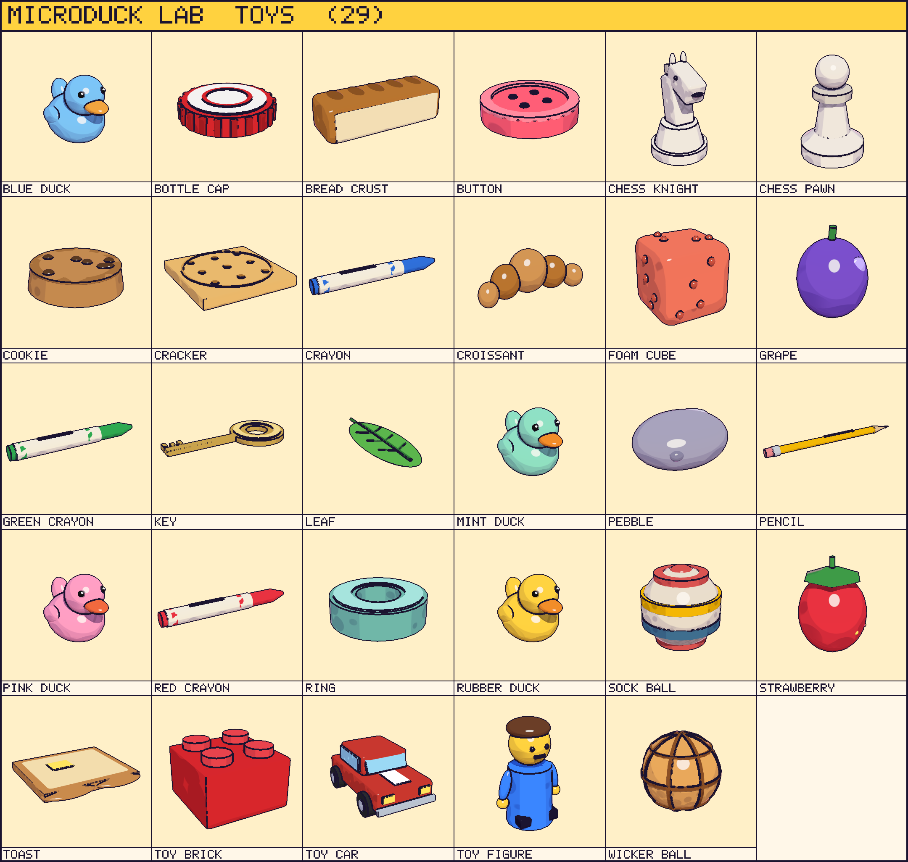

**Furniture (36)**

<b>Clutter (172)</b>

## Credits and licence

- The **Microduck robot** is by [Pollen Robotics](https://github.com/pollen-robotics/microduck_rl), licensed
  [CC BY-NC-SA 4.0](https://creativecommons.org/licenses/by-nc-sa/4.0/), used with modifications, **non-commercial only**.
- Other assets and their licences: [CREDITS.md](CREDITS.md).
- Code: [MIT](LICENSE). The MIT licence does not cover the third-party assets.
