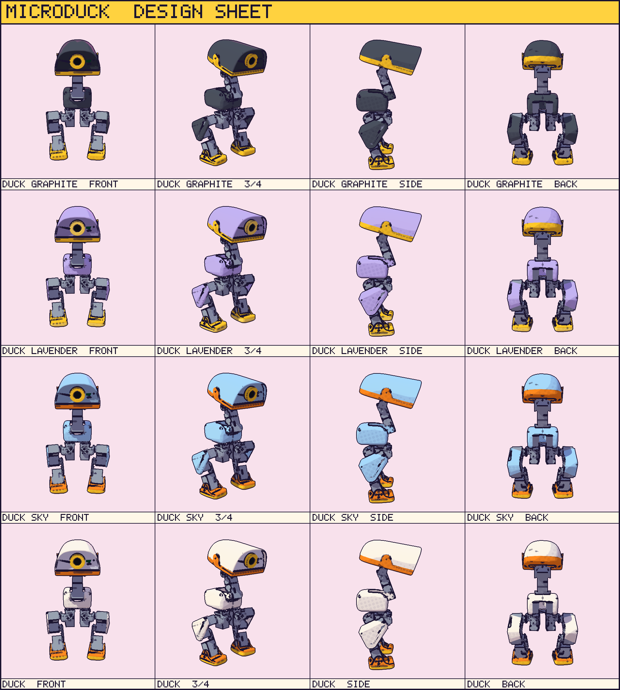
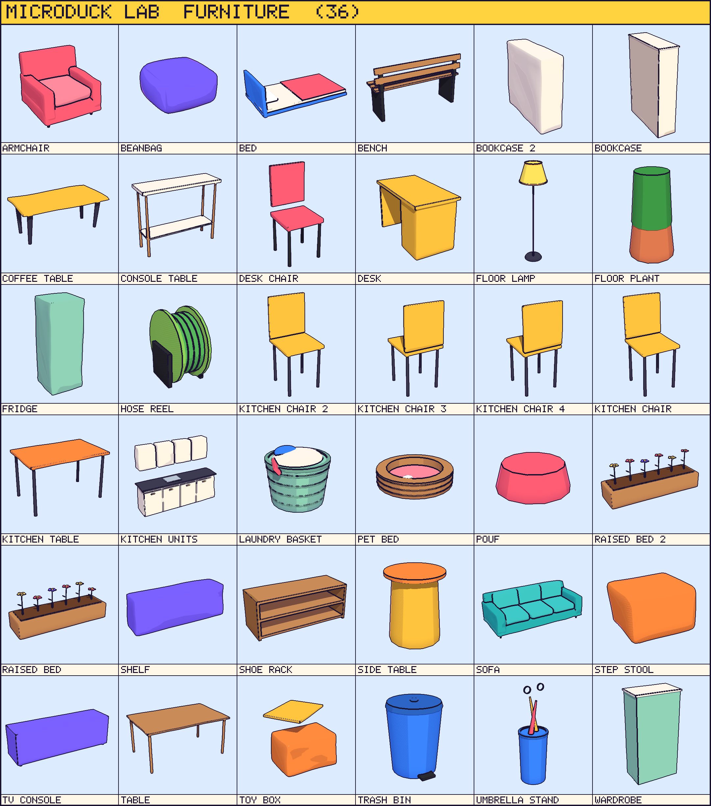
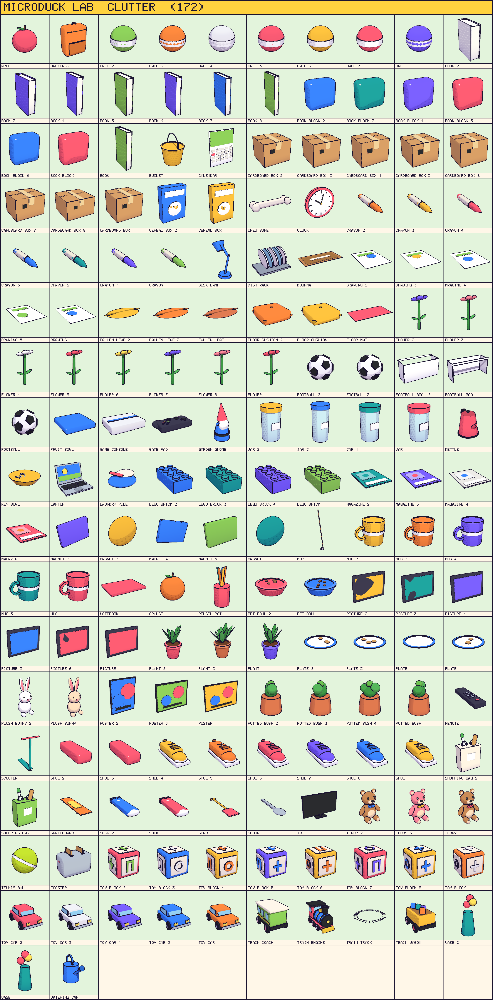

<h1 align="center">Microduck Lab VR</h1>

  Be the duck. A first-person VR version of <a href="https://github.com/R1chi33333/microduck-lab">Microduck Lab</a>:
  you are a 25 cm robot duck in a human-sized comic-book house, with a flock of other ducks who all have their own plans. 
  <b>Work in progress.</b>

---

## Status

All milestones of the port are in: the house, the flock, toys and the toy bag, roller skates, the laser,
football, the house race, emotes, swapping ducks, third person, the mirror, the garage and a first-run tutorial.
The browser version is [here](https://r1chi33333.github.io/microduck-lab-preview/); the plan is in
[docs/PORTING_PLAN.md](docs/PORTING_PLAN.md).

## Platform

- Unity 6000.6.7f1, Universal Render Pipeline, OpenXR
- Windows PC, Meta Quest Pro over Quest Link / Air Link

## Playing

To install the game on another PC (no Unity needed), follow [docs/INSTALL.md](docs/INSTALL.md)
([中文](docs/INSTALL.zh-CN.md)).

1. Connect the Quest Pro with Quest Link and set Meta Horizon Link as the active OpenXR runtime.
2. Run `Builds/Windows/MicroduckLabVR.exe` (make it with **Microduck > Build Windows**), or open the project
   in Unity 6000.6.7f1 and press Play in `Assets/MicroduckVR/Scenes/House.unity`.

| Control | What it does |
|---|---|
| Left stick | Walk towards where you look (on skates: steer) |
| Right stick | Snap turn; in third person it aims your head (click: view behind you) |
| Right trigger | Open the beak; let go next to a toy to grab it, squeeze again to drop |
| A | Chirp |
| B | Roller skates on / off (left grip: drift, left trigger: boost) |
| X | Dance (at the mirror: bring out the board to make your duck) |
| Y | Toy bag: toys, bin, help, credits, football, race, swap duck, view, emotes |
| Right grip | Laser dot for the ducks to chase |
| Left stick click | First / third person |

On the desktop without a headset: WASD walk, Q/E turn, Space beak, C chirp, K skates, Tab bag, L laser, V view.

Two players on two PCs in the same house (local network, no accounts): **HOST** and **JOIN** in the toy bag,
see [docs/MULTIPLAYER.md](docs/MULTIPLAYER.md).

## Design sheets and reusable items

Every toy, piece of furniture, bit of household clutter and the duck itself is also a separate Unity prefab
(`Assets/MicroduckVR/Prefabs/`), with the comic materials. To use them in your own Unity 6 URP project, download
`MicroduckLab_Assets.unitypackage` from [Releases](https://github.com/R1chi33333/microduck-lab-vr/releases) and
double-click it. The item list, sizes and licences are in [docs/ASSETS.md](docs/ASSETS.md).

**The duck** in its four colourways:

**Toys (29)**

**Furniture (36)**

<b>Clutter (172)</b>

## Credits and licence

- The **Microduck robot** is by [Pollen Robotics](https://github.com/pollen-robotics/microduck_rl), licensed
  [CC BY-NC-SA 4.0](https://creativecommons.org/licenses/by-nc-sa/4.0/), used with modifications, **non-commercial only**.
- Other assets and their licences: [CREDITS.md](CREDITS.md).
- Code: [MIT](LICENSE). The MIT licence does not cover the third-party assets.
