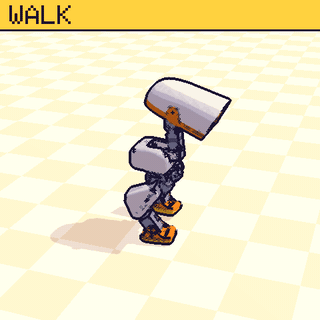
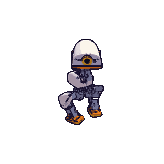
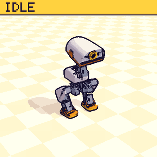
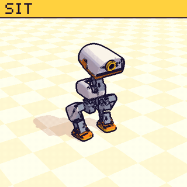
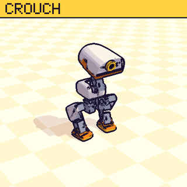
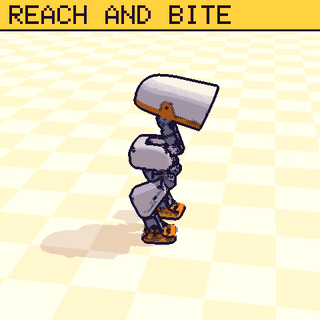
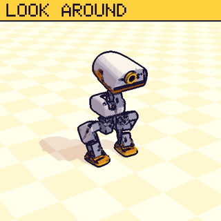
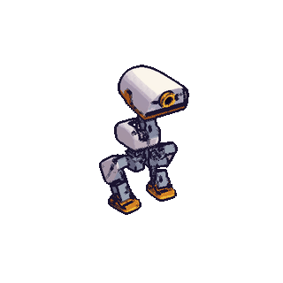
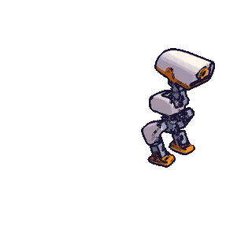

# 鸭子是怎么工作的

[English](../README.md#how-the-ducks-work)

在游戏里，鸭子**不用动画片段，也不用 Animator**。每个动作都是代码每一帧根据机器人的 15 个关节实时算出来的，和网页版的做法一样。这 15 个关节是：左右腿各 5 个（`hip_yaw`、`hip_roll`、`hip_pitch`、`knee`、`ankle`），加上 `neck_pitch`、`head_pitch`、`head_yaw`、`head_roll` 和 `jaw`（嘴）。

你自己的鸭子和 AI 鸭子用的是同一套身体代码，区别只在于由谁来控制：你的手柄，或者 AI 大脑。

## 所有动作

下面都是用游戏里鸭子自己的代码录下来的。每个下面的名字，就是它的动画片段名（`Duck_<名字>.anim`），也是 Animator 里触发它用的名字。

<table>
<tr><td align="center"> <code>Walk</code></td><td align="center"> <code>Turn</code></td><td align="center"> <code>Idle</code></td><td align="center"> <code>Sit</code></td></tr>
<tr><td align="center"> <code>Crouch</code></td><td align="center"> <code>Hop</code></td><td align="center"> <code>Bite</code></td><td align="center"> <code>Nod</code></td></tr>
<tr><td align="center"> <code>Shake</code></td><td align="center"> <code>Look</code></td><td align="center"> <code>Dance</code></td><td align="center"> <code>Wiggle</code></td></tr>
<tr><td align="center"> <code>FallGetUp</code></td></tr>
</table>

这些动作也做成了 **Unity 动画**，在 `Assets/MicroduckVR/Prefabs/Ducks/Animations/` 里（`.unitypackage` 里也有）：

- `Duck (animated).prefab`：带 Animator 的鸭子，直接拖进场景就能用。默认在发呆；调用 `animator.SetTrigger("Dance")` 这样的触发器就会做对应动作，一次性的动作做完会自己回到发呆。
- `Duck.controller`（每个动作一个状态、一个触发器）和 13 个动画片段 `Duck_*.anim`（30 帧每秒；发呆、走路、转身是循环的）。走路是原地走，要走起来得自己移动鸭子。

这些是"录下来的"动画，游戏本身还是用代码实时驱动鸭子。在 `DuckBody.cs` 里改了动作之后，用菜单 **Microduck > Assets > Bake Duck Moves** 重新录一遍即可（GIF 是用它输出到 `Logs/motion/` 的帧做的）。

## 代码在哪里

| 文件（在 `Assets/MicroduckVR/` 下） | 作用 |
|---|---|
| `Scripts/Flock/DuckBrain.cs` | **AI 鸭子的大脑。** 决定每只鸭子做什么，带它在房子里走，玩游戏，去叼玩具。 |
| `Scripts/Duck/DuckBody.cs` | **所有动画：** 走路、转身、坐下、蹲下、跳、转头看、伸嘴和张嘴、表情动作、轮滑、摔倒和爬起来。 |
| `Scripts/Duck/DuckSetup.cs` | 游戏开始时组装鸭子：读 `Models/microduck_rig.glb` 和 `Models/DuckJointMap.asset`（关节轴向、角度限制、站姿），再上颜色。 |
| `Scripts/Flock/ThoughtBubbles.cs` | AI 鸭子头上的漫画对话气泡，每种行为有一组台词。 |
| `Scripts/Audio/DuckAudio.cs` | 每只鸭子自己的叫声和脚步声，对大脑发出的事件做反应。 |
| `Scripts/Flock/FlockSpawner.cs` | 玩具包里的 ADD DUCK / REMOVE DUCK（1 到 12 只）。 |
| `Editor/SceneBuilderHouse.cs` | 开场的 6 只鸭子：站在哪、什么颜色、随机种子（菜单 **Microduck > Build House**）。 |
| `Scripts/Net/NetFlock.cs` | 联机：主机的大脑做决定，加入方的鸭子照着做。 |
| `Scripts/Player/PlayerDuck.cs` | 你自己的鸭子（同一个 `DuckBody`，由手柄控制）。 |
| `Scripts/Flock/WanderDuck.cs` | 一个很简单的大脑，只给其他项目用的 `Duck (live)` prefab 用。 |

## AI 鸭子会做什么

计时器到点后，鸭子随机挑下一个行为（`DuckBrain.Pick`）：

| 行为 | 概率 | 持续时间 | 表现 |
|---|---|---|---|
| `follow` 跟随 | 30% | 8 到 16 秒 | 排成松散的 V 字跟在你身后；两个玩家时，鸭子分成两队各跟一个人。 |
| `wander` 闲逛 | 24% | 7 到 13 秒 | 走到附近随机一个点，到了有时做个表情。 |
| `toy` 玩玩具 | 14% | 最多 14 秒 | 找 70 厘米内的玩具，走过去，低头，叼起来，叼着走约 4.5 秒，放下。 |
| `roam` 串门 | 12% | 最多 40 秒 | 穿过门口走到另一个房间。 |
| `sit` 坐下 | 10% | 3 到 6 秒 | 坐下歇一会儿。 |
| `idle` 发呆 | 10% | 1.5 到 3.5 秒 | 站着，一半概率做个表情。 |

下面这些情况一出现，就会盖过上面的日常行为（`DuckBrain.Games`）：

- **赛跑：** 沿赛道跑，每只鸭子速度略有不同，到终点跳舞。
- **足球：** 每队离球最近的两只鸭子去追球，往对方球门踢；其他的守位置。进球那一队全体跳舞。
- **激光点：** 80 厘米内的鸭子围着光点站成一圈，然后蹲下、扑上去。

一直都在做的：
- 和其他鸭子、和你保持约 19 厘米的距离；
- 提前探测前方的边缘和家具并绕开；
- 卡住了会自己脱困；
- 你在看卡片或面板时会让开，不挡视线；
- 在瓷砖上打滑，在水里变慢，在床上弹跳。

发生事情时，鸭子会通知气泡和声音：`got`（叼到了）、`drop`（放下了）、`bed`、`water`、`tile`。

## 身体能做的动作（都在 `DuckBody.cs`）

| 动作 | 怎么控制 |
|---|---|
| 走路、原地转身 | 程序化步态：用腿部 IK 落脚和迈步，内八字；身体随速度摇摆、起伏、前倾 |
| 坐下、蹲下 | `SitTarget`、`CrouchTarget`（会平滑过渡） |
| 跳 | `Hop`（高度）；床上弹跳和扑激光点用的就是它 |
| 看向某处 | `LookAt.target` / `LookAt.weight`；走路时头保持稳定，发呆时会歪头 |
| 伸嘴够东西、张嘴闭嘴 | `ReachState`（脖子和头弯到嘴碰到目标为止）、`JawTarget` |
| 开心地扭一扭 | `HappyWiggle` |
| 表情动作 | `PlayEmote("nod" / "shake" / "look" / "dance")`：点头、摇头、东张西望、跳舞 |
| 轮滑 | 蹬地、转弯侧倾、晃动（由轮滑代码设置） |
| 摔倒和爬起来 | `StartTip(方向)`：倒下、躺一会、自己撑起来。`StartTumble` / `LandTumble` 是翻滚。**目前只有你的鸭子会摔**（轮滑撞到东西），AI 鸭子不会摔。 |

## 想加新动作或新行为，要改哪里

### 加一个新表情（比如 `"bow"` 鞠躬、`"spin"` 转圈）

1. `Scripts/Duck/DuckBody.cs`：在 `PlayEmote` 里给它设时长，在 `EmoteOffsets` 里加一个 `case "bow":`。可以返回两类偏移，都乘上 `env`，这样动作会平滑开始和结束：
   - 身体的：`ox`、`oy`、`opitch`、`oyaw`、`oroll`；
   - 头的：`gy` 是转头，`gp` 是点头。
2. 想让 AI 鸭子也做：在 `DuckBrain.cs` 的表情列表里加上 `"bow"`。一处在 `Pick` 里（发呆时），一处在 `wander` 分支里（走到目的地时）。
3. 想让玩家也能做：在 `Scripts/Player/BagMenu.cs` 的 `Actions` 里加一个按钮。现在 4 × 4 已经满了，要替换一个或加一行。
4. 联机不用另外改：表情是按名字通过网络发送的。两台电脑都要用新版本。
5. 想把它也做成动画片段和 GIF：加到 `Editor/MotionBake.cs` 的 `Moves()` 里，再运行 **Bake Duck Moves**。

### 加一个新行为（比如 `"nap"` 睡觉）

1. `Scripts/Flock/DuckBrain.cs`：
   - 在 `Pick` 里加上它的概率和时长；
   - 在 `Think` 里加一个 `case "nap":`，返回走路速度和转向速度 `(speed, turnRate)`；
   - 要走到某处，用 `SteerAvoid(目标, 速度, 容差)`；
   - 摆姿势用上面那些身体控制（`SitTarget`、`LookAt`、`PlayEmote` 等）。
2. `Scripts/Flock/ThoughtBubbles.cs`：在 `Lines` 里加台词，比如 `{ "nap", new[] { "Zzz..." } }`。
3. 要配声音：在大脑里调用 `OnEvent?.Invoke(this, "事件名", 内容)`，再到 `Scripts/Audio/DuckAudio.cs` 里处理。
4. 要做一个"接管一切"的新玩法（像赛跑那样）：加到 `DuckBrain.cs` 的 `Games()` 里。

### 加一种新的身体姿势（比如真正的跳跃、用腿的大幅舞蹈）

在 `DuckBody.Step` 里加一个像 `SitW`、`CrouchW` 那样的权重，然后有两种做法：
- 用 `SetQ(关节, 角度)` 加 `ApplyJoint(关节)` 直接摆关节；
- 或者在 `SolveLeg` 之前改脚的目标位置。

关节的角度限制和轴向在 `Models/DuckJointMap.asset` 里。别超出这些限制，这样动作才和真机器人做得到的一样。

### 两条规矩

- 不要用代码让**你自己的**镜头翻滚、晃动或俯仰，VR 会晕。
- 数值都用米（鸭子大约 25 厘米高）。
